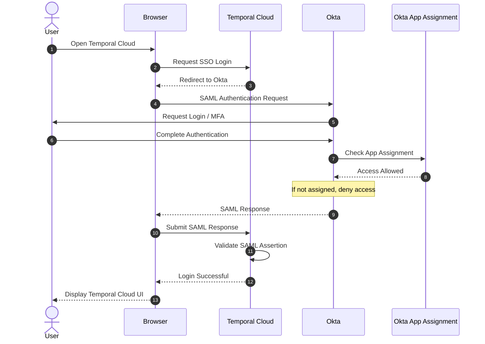

Okta authenticates the user and checks whether the user is assigned to the Temporal Cloud application (e.g., via the RBAC_TemporalCloud_users group). Temporal Cloud then validates the SAML assertion and applies its own RBAC policies to control resource access.

Key distinction:
- Okta Authentication: Verifies who the user is.
- Okta App Assignment: Determines whether the user is allowed to access the Temporal Cloud application, e.g., through membership in RBAC_TemporalCloud_users.
- Temporal Cloud RBAC: Controls what the user can do after login, such as accessing namespaces and executing workflows.

Okta supports two ways to assign users to an application:
1. Direct User Assignment: Assign an individual user directly to the Temporal Cloud application.
2. Group Assignment: Assign a group (e.g., RBAC_TemporalCloud_users) to the Temporal Cloud application. All users in that group inherit access.
Both methods can be used simultaneously.

The RBAC_TemporalCloud_users group is not required for Okta SSO. It is simply a convenient way to manage application access for multiple users.

Note that App Assignment controls whether a user can access the application through Okta SSO. It is separate from Temporal Cloud's internal RBAC, which controls namespace and API permissions.

**Key Points:**

- **Authentication:** Okta verifies the user's identity through SSO.
- **App Assignment:** Okta checks whether the user is assigned to the Temporal Cloud application. Assignment can be configured directly for individual users or through groups (e.g., `RBAC_TemporalCloud_users`).
- **Temporal RBAC:** Temporal Cloud independently manages namespace and API permissions after login.

**Key Points:**

- **Authentication:** Okta verifies the user's identity.
- **App Assignment:** Okta checks whether the user has access to the Temporal Cloud application, either through direct user assignment or group assignment (`RBAC_TemporalCloud_users`).
- **Temporal RBAC:** Temporal Cloud independently controls namespace and API permissions after login.
