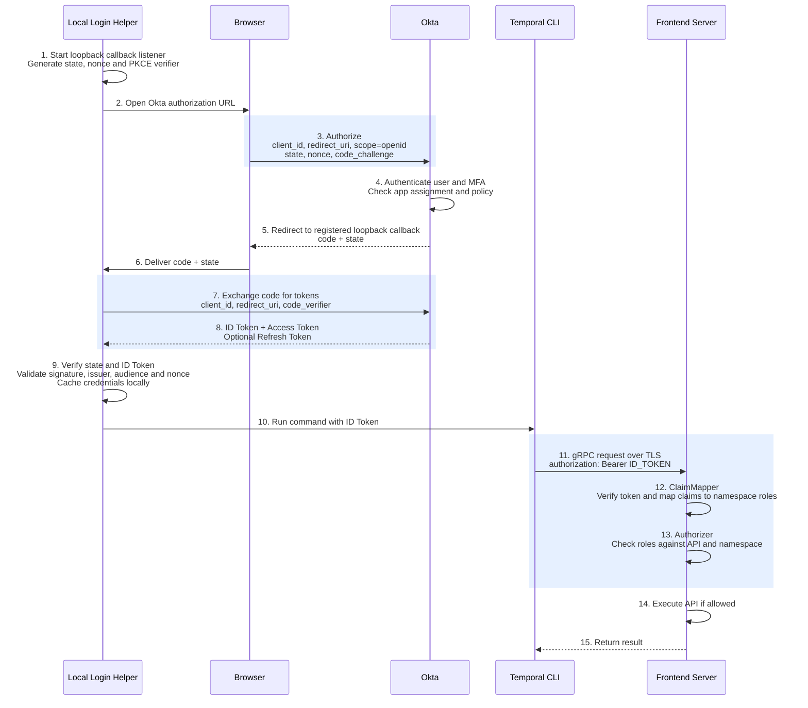
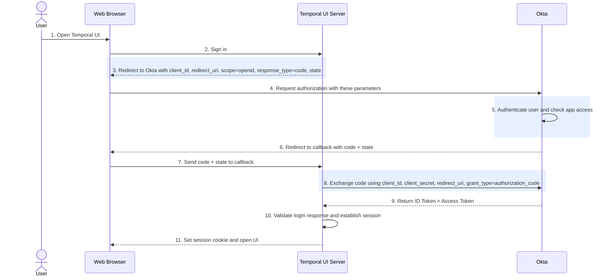

### 总结下，感觉有多种方式
- 完全不关注Group，拿到user，自查表。 这种tf文件可以沿用当前格式，减少业务团队提交 PR的成本。自己搞个 terraform provider即可。
- JWT带 permission claim, 这需要有provider，自己的auth平台给okta转的。但是长度有些限制，一般也就是4k/8kb这种，因为放在grpc meta中，取链路中最小值. 当然也可以用*或者啥的
  例如：
  ```yaml
  {
  "iss": "https://company.okta.com/oauth2/default",
  "sub": "00u123abc",
  "aud": "temporal-frontend",
  "exp": 1793000000,
  "permissions": [
    "orders-dev:write",
    "orders-prod:read"
  ]
}```
- 使用JWT token的group信息，用组名规则，比如 namespaceA-read, namespaceA-admin。这有个问题：如果一个人能访问多个namespace，需要加入很多组。但是JWT是有长度限制的。
- 另外okta带的可能是role + permission，
- 使用group，但是不依赖于组名，也搞ACL映射表，ACL 映射表可以是多种，AI 还提到一个git作为source of truth的方式： 就是自己定义文件格式，FrontEnd直接去加载它。


(issuer, sub) 是用户的稳定身份标识；Authorizer 通常不需要用户名，只需要该用户已经解析出来的权限。
字段	含义	示例
iss（issuer）	哪个身份提供方签发了 token	https://company.okta.com/oauth2/default
sub（subject）	该签发方为用户分配的唯一标识	00u123abc
email / name	方便人识别的邮箱或姓名	alice@example.com / Alice


使用两者组合，是因为不同 issuer 可能出现相同的 sub；邮箱、用户名也可能修改。

例如 Okta 返回的 JWT 内容为：
{
  "iss": "https://company.okta.com/oauth2/default",
  "sub": "00u123abc",
  "email": "alice@example.com",
  "groups": ["temporal-orders-readers"]
}

鉴权过程是：
步骤	输入 → 结果
ClaimMapper 验证 token	确认这确实是可信 Okta 签发的有效 token
识别用户	(iss, sub) 标识该用户，email 用于展示和审计
解析权限	temporal-orders-readers → orders-prod: read
Authorizer 判断请求	请求读取 orders-prod → 允许；请求启动 Workflow → 拒绝


所以不是 Authorizer 拿用户名再查权限，而是 ClaimMapper 先把身份转换成权限，Authorizer 再判断权限是否允许当前操作。

如果你们要支持“直接给 Alice 授权”，数据库可以记录：
用户身份键	展示邮箱	Namespace	Role
(Okta issuer, 00u123abc)	alice@example.com	orders-prod	write


这时 ClaimMapper 根据 (iss, sub) 查询直接授权，再生成 Claims。用户名用于人看，稳定身份 ID 用于关联，角色权限用于鉴权。


## CLI 登陆和鉴权流程
**对于你们的 self-hosted + Okta，浏览器登录可以实现，但需要配套登录工具。采用 CLI 本地回调的方案时，token 由本机登录工具获取、保存，再交给 Temporal CLI；UI Server 不参与。**

我读取了当前 CLI、UI Server 的源码及文档，有一个重要补充：**CLI 已有 OAuth Access Token 的读取、刷新逻辑，但不能据此认为它自带通用的 Okta 浏览器登录能力，更不能认为它会自动管理 ID Token。**

### 源码实际提供了什么

| 代码 | 核对结果 |
|---|---|
| CLI [`cliext/client.go`](https://github.com/temporalio/cli/blob/5730c955d608c88bdc79de7910fe05a826cea314/cliext/client.go) | 接收 gRPC metadata；读取 OAuth 配置；请求时返回 `AccessToken`，必要时刷新并保存 |
| CLI [`cliext/config.oauth.go`](https://github.com/temporalio/cli/blob/5730c955d608c88bdc79de7910fe05a826cea314/cliext/config.oauth.go) | 保存 access token、refresh token、过期时间和 OAuth 配置；没有专门保存 ID Token 的字段 |
| UI Server [`server/route/auth.go`](https://github.com/temporalio/ui-server/blob/9ba7e3c8b2c23a7dfc6597cc688ff0b5fe455f46/server/route/auth.go) | UI 登录回调由 UI Server 接收，并调用 `ExchangeCode` 兑换 token |
| UI Server [`server/auth/auth.go`](https://github.com/temporalio/ui-server/blob/9ba7e3c8b2c23a7dfc6597cc688ff0b5fe455f46/server/auth/auth.go) | UI 登录 token 会写入浏览器 Cookie；支持把 ID Token 替换为发往后端的 Bearer 凭据 |

以上是当前 `main` 的代码检查结果，**不保证你们安装的发行版已经包含全部能力**。官方文档中的 `temporal cloud login` 则属于 Cloud 扩展。

参考：[Use with Temporal Cloud](https://docs.temporal.io/cli/cloud)。

### 建议的 CLI 登录与鉴权流程

下面按你们倾向的 **ID Token** 画。图中的 **Login Helper 是需要复用或补充的本地工具，不是原生 `temporal login` 命令**。为控制图宽，Frontend 内部的 ClaimMapper、Authorizer 用自身调用表示。



PKCE 的 code 兑换由本地应用完成，Okta 返回 ID Token、Access Token，以及可选的 Refresh Token；浏览器在回调中通常传递的是 **code，不是最终 JWT**。

参考：[Okta Authorization Code with PKCE](https://developer.okta.com/docs/guides/implement-grant-type/authcodepkce/main/)。

### Token 到底由谁拿着？

| 场景 | 谁兑换 token | 谁保存 / 管理 | 请求经过 UI Server 吗？ |
|---|---|---|---|
| **CLI 本地回调方案** | 本机 Login Helper | 本机工具缓存，CLI 调用时取得 token | **不经过** |
| **Temporal UI 登录** | UI Server | 当前实现通过浏览器 Cookie 等管理登录状态 | 经过 |
| CLI 借用 UI 登录回调 | 需要专门实现安全交接 | 取决于自定义方案 | 非现成通用能力 |

**“浏览器参与登录”不意味着“必须经过 Temporal UI”。** 浏览器只是打开 Okta 登录页面；已经存在的 Okta SSO 会话可能让用户免输密码，但 UI 和 CLI 仍各自获取 token。

### 你们需要配置的关键点

| 位置 | 要配置什么 |
|---|---|
| Okta | 单独的 Native Application，例如 `TemporalLocalCLI`；启用 Authorization Code + PKCE |
| CLI 回调 | 注册本地回调，例如 `http://127.0.0.1:指定端口/callback`；必须满足 Okta 的 redirect URI 匹配规则，不能随意替换 UI callback |
| ID Token claims | 配置 `groups` 或 `permissions` |
| Frontend ClaimMapper | 信任正确 issuer / JWKS；明确允许 CLI 的 `client_id` 作为 ID Token audience |
| 权限 | 复用 UI 的 group 映射，或者读取 token 中的 Temporal `permissions` |
| 本地工具 | 完成登录、ID Token 验证、缓存、续期和 CLI 注入 |

**如果用 ID Token，就需要由 Login Helper 明确管理 ID Token 的更新。** 当前 CLI 的 OAuth 自动刷新路径使用的是 **Access Token**，不能直接拿来当作 ID Token 刷新方案。

最终发送请求可使用官方支持的 metadata 参数：

```bash
temporal workflow list \
  --address temporal.example.com:7233 \
  --namespace orders-prod \
  --tls \
  --grpc-meta "authorization=Bearer ${TEMPORAL_ID_TOKEN}"
```

`--grpc-meta` 是官方参数；上面的 `authorization=Bearer …` 是结合该参数格式与服务端 Bearer 要求得到的用法，**不是文档中原样提供的 Okta 登录示例**。服务端再执行 ClaimMapper → Authorizer。

参考：

- [Temporal CLI Global Flags](https://docs.temporal.io/cli/command-reference/env#global-flags)
- [Self-hosted Temporal Security](https://docs.temporal.io/self-hosted-guide/security)


## 问答

### ClaimMapper 把身份转成权限，参照什么转呢？


参照你们预先配置的“授权规则”转换。ClaimMapper 不会从身份本身推断出权限。

比如，你们在 Git 或权限数据库中维护：
主体类型	主体	Namespace	权限
Okta group	orders-developers	orders-dev	read, write
Okta group	orders-oncall	orders-prod	read
SPIFFE ID	spiffe://corp/orders-worker	orders-prod	worker
- 但是实际上考虑当前有多个domain，都允许它访问。那么可能就不好映射了。之前没有约定一定如何。


ClaimMapper 处理两类请求时：
请求	从已验证凭据中提取	查询上述规则	输出 Temporal Claims
Alice 通过 UI 操作	groups: ["orders-oncall"]	该组有生产订单 namespace 的读权限	orders-prod → RoleReader
订单 Worker 调用	spiffe://corp/orders-worker	该工作负载有 worker 权限	orders-prod → RoleWorker


随后 Authorizer 拿这些 Claims，与当前请求的 API 和 namespace 比较，决定允许还是拒绝。

因此三部分各有一个依据：
部分	依据什么
认证	Okta 签名 / SPIRE 证书，确认“你是谁”
ClaimMapper	你们维护的授权规则，得到“你有什么权限”
Authorizer	API 所需角色，判断“当前操作能不能执行”


另外，内置 JWT ClaimMapper 是另一种方式：它直接读取 token 中已经包含的 permissions，例如 orders-prod:read。你们如果只在 token 中放 Okta groups，就需要自定义 ClaimMapper，完成 group → namespace 权限 的查询与转换。


### 那对于工作负载,SPIFFE ID 怎么变换成role?


通过预先维护的 SPIFFE ID → namespace → role 授权规则，由自定义 ClaimMapper 查询并转换。SPIFFE ID 本身不包含 Temporal role。

例如，权限数据库中保存：
SPIFFE ID	Namespace	Roles
spiffe://corp/orders-worker	orders-prod	worker
spiffe://corp/orders-api	orders-prod	write
spiffe://corp/orders-api	orders-dev	read, write


以订单 Worker 为例：
步骤	具体动作
1. SDK 连接	使用 SPIRE 签发的 X.509-SVID 建立 mTLS 连接
2. Frontend 验证	TLS 层验证客户端证书链
3. ClaimMapper 提取身份	从已验证证书的 URI SAN 读取 spiffe://corp/orders-worker
4. 查询授权规则	用完整 SPIFFE ID 查询数据库或本地缓存
5. 构造 Claims	将 worker 转成 Temporal 的 RoleWorker
6. Authorizer 检查	判断当前 API、namespace 是否被这些角色允许


第 5 步的输出概念上是：
Claims{
    Subject: "spiffe://corp/orders-worker",
    Namespaces: map[string]Role{
        "orders-prod": RoleWorker,
    },
}

这条授权规则由你们的平台管理员配置，例如 Git PR → CI → 权限数据库；SPIRE 只负责签发和更新身份证明。即使某个服务拿到了合法的 SVID，如果授权表中没有对应规则，也应拒绝其业务请求。

不建议仅凭 ID 名称含有 worker 就自动赋予 worker 权限，应明确配置完整身份与权限的映射。


### ClaimMapper代码能区分请求来自于workload还是user么？

可以，但需要你们在自定义 ClaimMapper 中定义区分规则；Temporal 不会自动替你判断是人还是程序。

GetClaims(authInfo) 能获得两类信息：
输入	内容	可以识别什么
authInfo.AuthToken	gRPC 请求携带的 Bearer token	验证 Okta JWT 后识别用户
authInfo.TLSConnection	TLS 连接信息，包括客户端证书	从已验证证书的 URI SAN 识别 SPIFFE 工作负载


你们的方案中，UI Server 本身也是 workload，所以不能简单按“有证书就是程序、有 token 就是人”区分。 应结合可信调用方判断：
客户端证书身份	用户 token	按什么身份鉴权
指定的 UI Server SPIFFE ID	有效 Okta 用户 JWT	用户
指定的 UI Server SPIFFE ID	缺失或无效	拒绝
已授权的业务 SPIFFE ID	无	工作负载
业务 SPIFFE ID	有	按当前方案拒绝，避免身份混用


伪代码：
peerID := verifiedSPIFFEID(authInfo.TLSConnection)

if peerID == trustedUIServerID {
    user := verifyOktaUserToken(authInfo.AuthToken)
    return claimsForUser(user)
}

if authInfo.AuthToken != "" {
    return deny("unexpected token")
}

return claimsForWorkload(peerID)

这里的 verifyOktaUserToken 必须验证签名、issuer、audience 等，并确保是约定的用户 token。区分依据是经过验证的凭据及入口规则，不是请求中的用户名、SDK identity 或自报的 user/workload 字段。



配置位置	需要准备 / 配置
Okta	创建 OIDC Web Application，启用 Authorization Code
Okta	注册 UI 的回调地址 redirect_uri，为用户或 Group 分配应用访问权限
Temporal UI Server	TEMPORAL_AUTH_ENABLED=true
Temporal UI Server	TEMPORAL_AUTH_PROVIDER_URL：Okta 的 OIDC Issuer URL
Temporal UI Server	TEMPORAL_AUTH_CLIENT_ID、TEMPORAL_AUTH_CLIENT_SECRET：来自 Okta 应用
Temporal UI Server	TEMPORAL_AUTH_CALLBACK_URL：与 Okta 注册的 redirect_uri 一致
Temporal UI Server	TEMPORAL_AUTH_SCOPES：包含 openid，按需添加 profile,email

背景：当前公司使用temporal cloud，身份验证是基于okta，用了corp AD这个应用的RBAC_temporalCloud_user 做UI的身份验证，具体权限是通过git->terraform->temporal cloud同步的，支持按照user和group配置权限。后续希望自部署Temporal。
目的：我当前考虑自部署的情况下的human user management的权限问题。依然可以用okta。从UI登陆认证，希望用okta做sso。
问题1: 是搞个单独的okta应用，比如叫TemporalLocal，还是直接用corp AD这个应用的RBAC_temporalLocal_user?
问题2: 权限管理选择：1）全部在git配置？包括user和group权限都支持？2）git只管group的权限，然后okta管理user到group的关系？分别有什么好处？
要求：希望你的回答给予真实的文档和代码分析，然后简练一点，比如借助一些表格比较。


**建议方案：独立 Okta 应用 `TemporalLocal` 负责 SSO；Okta 管理登录资格及组成员；Git 独立管理 Temporal 权限，通过已有流程同步到自部署集群。**

## 一、SSO：应用、用户、组分别负责什么？

当前 Temporal Cloud 的企业 SSO 使用 SAML；自部署 Temporal UI 原生支持 OIDC，可在同一个 Okta 租户中新建 `TemporalLocal` OIDC 应用，不必照搬 Cloud 的配置。

| 对象 | 作用 | 是否必需 |
|---|---|---|
| `TemporalLocal` Okta 应用 | 配置 Client ID、回调地址、登录策略等，供 UI 接入 SSO | 需要配置对应的 SSO 应用，建议独立创建 |
| 应用的用户分配 | 指定某个用户可以通过该应用登录 | 可以直接分配用户 |
| 应用的组分配 | 指定某个组的成员均可通过该应用登录 | 可选，可与用户直接分配同时使用 |
| AD 的 `RBAC_temporalLocal_user` 组 | 作为统一登录资格组 | **不必创建** |
| Token 的 `groups` claim | 向 Temporal 传递当前用户所属的相关组 | 使用 Okta 组进行授权映射时需要 |

**“把组分配给应用”只赋予组成员登录资格，不赋予 Temporal Namespace 权限。**将用户直接分配给应用，同样只解决登录资格。

另外，应用分配与 Token 的 groups claim 是独立配置：**分配组不会自动让 Token 携带组信息**，需要配置 claim 过滤器或 allowlist。

官方依据：

- [Temporal Cloud 访问管理](https://docs.temporal.io/cloud/manage-access)
- [自部署 UI OIDC 配置](https://github.com/temporalio/ui/blob/main/AUTHENTICATION.md)
- [Okta 应用用户/组分配](https://help.okta.com/en-us/Content/topics/apps/apps-configure-settings.htm)
- [Okta groups claim 配置](https://developer.okta.com/docs/guides/customize-tokens-groups-claim/main/)

## 二、是否继续使用 AD 的组？

员工账号可以继续来自企业 Active Directory，**但 TemporalLocal 的权限组不必建在 AD 中**。

| 选择 | 优势 | 劣势 |
|---|---|---|
| **在 Okta 创建 Local 权限组** | 无须修改 AD；Local 成员管理相对独立 | 需建立组负责人、成员审批和清理机制 |
| 使用 AD 来源的组 | 复用企业现有 AD 管理流程 | 依赖 AD 管理权限、同步及跨团队协调 |
| 不使用组，直接分配用户 | 配置简单，适合人数较少 | 人多后逐人维护成本较高 |

推荐独立 Local 应用，是为了隔离 Cloud 与 Local 的回调地址、客户端凭据和配置变更；**不是要求另建员工账号体系，也不是要求额外建立统一登录组。**

## 三、权限管理方案比较

你们已经具备：Local 独立 Git 权限文件、独立同步流程，以及可自定义的 ClaimMapper。因此以下方案都可实现。

| 方案 | Git 管什么 | Okta 管什么 | 优势 | 劣势 |
|---|---|---|---|---|
| **A：用户和组均可授权** | `user→权限`、`group→权限` | 登录资格、Okta 组成员 | 灵活，个人特殊授权方便 | 个人例外容易积累；退组后个人授权可能仍保留 |
| **B：仅通过 Okta 组授权，推荐** | `group→权限` | 登录资格、`user→group` | 人员变更集中在 Okta；Git 专注权限规则 | 审计需关联两处记录；需要管理权限组数量及负责人 |
| C：授权关系全部放 Git | `user→权限`，或逻辑组的成员及权限 | 登录资格、用户认证 | 授权配置统一走 PR，不依赖 Okta 组 | Git 承担人员成员关系维护；登录资格仍需在 Okta 管理 |

**日常采用 B；确有个人例外需求时，可采用 A，并限制个人授权期限。**如果要求所有人员授权变更都必须走 PR，则 C 更符合该治理目标。

## 四、推荐方案的具体流程

| 步骤 | 配置或行为 |
|---|---|
| 1．配置 SSO | 新建 `TemporalLocal` OIDC 应用，UI 配置对应的 Client ID、Secret、Issuer、回调地址 |
| 2．配置登录资格 | 将用户直接分配给应用，或将相关权限组分配给应用；两种方式可以混用 |
| 3．管理成员 | 例如 Alice 加入 Okta 组 `TemporalLocal_orders_operator` |
| 4．传递身份 | Token 返回可信用户标识，以及 Alice 所属的 Local 相关组 |
| 5．配置业务权限 | Git 定义 `TemporalLocal_orders_operator → orders Namespace: write` |
| 6．发布策略 | 独立流程将 Git 权限文件同步到 Local 集群并加载 |
| 7．执行授权 | 自定义 ClaimMapper 验证凭据、匹配策略、生成 Claims；Authorizer 检查每次 API 请求 |

## 五、代码依据与生效边界

基于此前检查的 Temporal Server **v1.32.1**：

| 组件 / 边界 | 结论 |
|---|---|
| [默认 ClaimMapper 源码](https://github.com/temporalio/temporal/blob/v1.32.1/common/authorization/default_jwt_claim_mapper.go) | 从 JWT 提取身份和权限；没有直接读取 Git 任意 user/group 映射的逻辑。你们可以自定义这部分 |
| [内置 Authorizer 源码](https://github.com/temporalio/temporal/blob/v1.32.1/common/authorization/default_authorizer.go) | 根据 Claims、目标 Namespace、API 所需角色判定权限；内置角色满足需求时，无须重写 |
| 登录成功但没有匹配权限 | 不授予业务操作权限，不能因为能登录就默认开放 Namespace |
| Git 权限变更 | 在同步、加载及相关缓存更新后生效，不必等待身份 Token 更新 |
| Okta 组成员变更 | 如果组信息来自 JWT，旧 Token 中的组不会自动变化，需明确刷新或失效时效 |
| Token 类型 | 确保 groups 位于 Frontend 实际验证的 Token 中；Okta org authorization server 支持 ID Token 的 groups，自定义 Access Token 的 groups 需 custom authorization server |

相关官方文档：

- [Temporal 自部署安全与授权扩展](https://docs.temporal.io/self-hosted-guide/security)
- [Okta groups claim 与 Token 类型](https://developer.okta.com/docs/guides/customize-tokens-groups-claim/main/)
