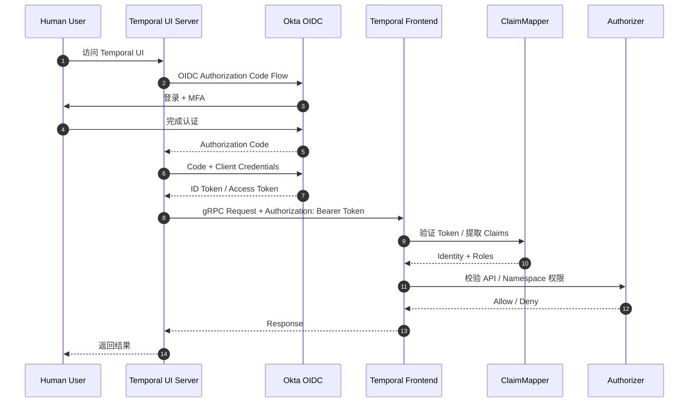

# Temporal Self-Hosted UI Server 集成 Okta OIDC 与 Bearer Token

## 1. 核心结论

**Temporal 开源版 UI Server 已经支持通过 Okta OIDC 登录，并支持将 ID Token 或 Access Token 作为 Bearer Token 传递给 Temporal Frontend。**

不需要为了该功能修改 UI Server 代码。

UI Server 提供专门的配置项：

`useIdTokenAsBearer`

用于决定使用哪一种 Token。

| 配置 | 默认值 | 行为 |
|---|---|---|
| `auth.enabled` | `false` | 开启 OIDC 登录 |
| `auth.providers[].type` | `oidc` | 配置 Okta 等 OIDC Provider |
| `auth.providers[].useIdTokenAsBearer` | `false` | 决定使用 ID Token 还是 Access Token |
| `TEMPORAL_AUTH_USE_ID_TOKEN_AS_BEARER` | `false` | 对应的 Docker 环境变量 |

具体行为：

- `false`（默认）：使用 `Authorization: Bearer <access_token>`
- `true`：使用 `Authorization: Bearer <id_token>`

官方文档和源码提供了相应支持。

## 2. Okta OIDC 配置示例

如果希望使用 Okta ID Token：

```yaml
auth:
  enabled: true
  providers:
    - label: Okta
      type: oidc
      providerUrl: https://example.okta.com/oauth2/default
      clientId: your-client-id
      clientSecret: your-client-secret
      scopes:
        - openid
        - profile
        - email
      callbackUrl: https://temporal.example.com/auth/sso/callback
      useIdTokenAsBearer: true
```

说明：

- `providerUrl`：Okta Authorization Server 的地址。
- `clientId`：Okta Application 的 Client ID。
- `clientSecret`：Okta Application 的 Client Secret。
- `scopes`：OIDC 请求的 Scope。
- `callbackUrl`：Okta 登录完成后的回调地址。
- `useIdTokenAsBearer: true`：使用 ID Token 作为 Bearer Token。

如果设置为 `false`，则默认使用 Access Token。

## 3. 整体认证与授权流程



说明：

1. Human User 通过 Okta OIDC 登录。
2. UI Server 完成 Authorization Code Flow。
3. UI Server 获得 ID Token 和 Access Token。
4. 根据 `useIdTokenAsBearer` 选择 Token。
5. UI Server 将 Bearer Token 携带给 Temporal Frontend。
6. Frontend 通过 ClaimMapper 验证和解析 Token。
7. Frontend 通过 Authorizer 检查访问权限。

注意：以上是目标认证架构的逻辑流程。HTTP 请求认证头与 Frontend gRPC metadata 之间的具体转发链路，还需要结合所使用的 UI Server 版本进行源码核验。

## 4. UI Server 源码实现

### 4.1 配置定义

源码：

https://github.com/temporalio/ui-server/blob/main/server/config/config.go

相关配置：

```go
// Use ID token instead of access token as Bearer
// in Authorization header
UseIDTokenAsBearer bool `yaml:"useIdTokenAsBearer"`
```

该配置控制是否使用 ID Token 代替 Access Token 作为 Bearer Token。

### 4.2 Token 选择逻辑

源码：

https://github.com/temporalio/ui-server/blob/main/server/auth/auth.go

相关逻辑：

```go
if len(cfg.Auth.Providers) > 0 &&
    cfg.Auth.Providers[0].UseIDTokenAsBearer {

    if idToken != "" {
        c.Request().Header.Set(
            echo.HeaderAuthorization,
            "Bearer "+idToken,
        )
        c.Request().Header.Del(
            AuthorizationExtrasHeader,
        )
    }
}
```

含义：

1. 检查是否开启 `UseIDTokenAsBearer`。
2. 检查是否存在 ID Token。
3. 使用 ID Token 设置 HTTP Authorization Header。
4. 删除额外的 Authorization Header。

这段代码直接证明 UI Server 支持将 HTTP 请求的 Bearer Token 设置为 ID Token。

需要注意：

- 上述代码位于 HTTP 请求认证处理逻辑中。
- 单凭该代码片段，不能完整证明 HTTP Authorization Header 到 Frontend gRPC Metadata 的转发过程。
- 对于生产部署，建议进一步检查对应版本的 gRPC Client 和 Metadata 转发逻辑。

## 5. Self-Hosted Temporal 的职责划分

| 组件 | 职责 |
|---|---|
| Okta | 用户身份认证、MFA、Token 签发 |
| Temporal UI Server | OIDC 登录、会话管理、Token 处理和 Bearer 传递 |
| Temporal Frontend | 接收 API 请求，执行身份验证与授权流程 |
| ClaimMapper | 验证 Token，提取 Identity 和 Claims，映射角色 |
| Authorizer | 根据 Identity、Role、Namespace 和 API 检查权限 |

### 5.1 UI Server

已有基础能力：

- OIDC 登录。
- Authorization Code Flow。
- 使用 Client ID / Client Secret。
- 获取 ID Token / Access Token。
- 选择使用哪种 Token 作为 Bearer。
- Token 和 Session 管理。

因此，无需重新实现整个 Okta 登录流程。

### 5.2 Frontend

对于自部署 Temporal，如果需要企业级权限控制，仍然需要配置或实现对应的认证和授权逻辑。

主要包括：

**Token Verification**

- 验证 JWT Signature。
- 验证 `iss`。
- 验证 `aud`。
- 验证 `exp`。
- 验证 Token 类型。
- 处理 JWKS 公钥更新。

**ClaimMapper**

- 提取用户身份。
- 提取 `sub`、`email`、`groups` 或 `roles`。
- 将 Claims 映射到 Temporal 权限模型。

**Authorizer**

- 校验用户是否有访问对应 Namespace 的权限。
- 校验具体 API 操作的权限。
- 根据 Role 决定 Allow / Deny。

注意：Temporal Frontend 不会因为 UI Server 开启 OIDC，就自动完成自定义的 Token 验证和权限映射。

## 6. 使用 ID Token 还是 Access Token？

| 比较项 | ID Token | Access Token |
|---|---|---|
| 协议主要用途 | 证明用户身份 | 授权访问 API |
| 标准格式 | JWT | JWT 或 Opaque |
| Audience | 通常是 OIDC Client ID | 通常是资源服务器标识 |
| 用户身份信息 | 通常包含 `sub` 等 | 取决于 Authorization Server |
| Role / Group Claims | 可通过 Okta 配置 | 可通过 Okta 配置，取决于 Token 类型 |
| 作为 API Bearer | 非标准推荐模式 | 标准推荐模式 |
| Temporal UI Server 支持 | 支持 | 支持，默认 |

### 6.1 使用 ID Token 的考虑

优势：

- 通常是 JWT，便于 Frontend 本地验证。
- 包含明确的用户身份信息。
- 可以通过 Okta 配置自定义 Claims。
- UI Server 已经支持使用 ID Token 作为 Bearer。

注意事项：

- ID Token 的主要用途是向 OIDC Client 证明身份。
- 它并不是 OAuth 标准意义上的 API Access Token。
- 如果作为 Frontend API Bearer 使用，应明确这是企业内部约定的认证方案。
- Frontend 必须严格检查签名、Issuer、Audience、有效期及其他安全约束。
- 需要评估 Token 重放、Audience 绑定和权限管理风险。

### 6.2 使用 Access Token 的考虑

优势：

- 符合 OAuth 资源服务器的常规设计。
- 可以专门为 Temporal Frontend 配置 Audience。
- 可以使用 Scope 和自定义 Claims 表达权限。

注意事项：

- Access Token 不一定是 JWT。
- 如果使用 Okta JWT Access Token，需要选择适合由自部署 Frontend 验证的 Authorization Server。
- 需要确保 Claims 能够满足 Temporal ClaimMapper 的权限映射需求。

## 7. 与 SPIRE Workload 认证方案的关系

假设 Self-Hosted Temporal 同时支持：

- Human User：Okta OIDC。
- Workload：SPIRE / SPIFFE。
- Frontend：统一实现 ACL 和 Namespace 权限检查。

可以采用：

```text
Human User
    |
    v
Temporal UI Server
    |
    | Okta ID Token / Access Token
    v
Temporal Frontend
    |
    +--> Okta JWT Verification
    |         |
    |         v
    |     Human Identity
    |
    +--> SPIRE Token Verification <--- Workload
              |
              v
          Workload Identity
    |
    v
ClaimMapper
    |
    v
Unified Authorization
    |
    v
Namespace / API Permission Check
```

关键设计：

1. Human User 和 Workload 使用不同身份认证机制。
2. 两类 Token 应采用严格的验证规则区分。
3. 不应仅依据未经验证的 Claims 判断身份类型。
4. 验证完成后，可以映射到统一的授权模型。
5. Human 和 Workload 可具有不同的 Role / Permission。
6. 两种认证路径需要考虑故障隔离。

这里的 SPIRE Token Verification 指 JWT-SVID 路径。如果 Workload 使用 X.509-SVID/mTLS，则应通过 TLS 客户端证书验证身份，不能直接套用 Bearer Token 验证流程。

## 8. 最终结论

对于 Self-Hosted Temporal + Okta OIDC：

**UI Server 已经具备 OIDC 登录和 ID Token / Access Token Bearer 选择能力，不需要重新开发。**

推荐开发重点：

1. Frontend JWT Verification。
2. Human / Workload 身份区分。
3. 自定义 ClaimMapper。
4. Namespace 级权限映射。
5. 自定义或扩展 Authorizer。
6. Token 有效期、刷新和认证故障处理。
7. 端到端验证 UI Server 到 Frontend 的 Bearer Metadata 传递。

需要进一步核实的实现细节：

- 当前部署版本中，UI Server 如何将 HTTP Authorization Header 转换为 Frontend gRPC Metadata。
- ID Token 过期后的刷新逻辑。
- 多个 OIDC Provider 场景下的 Token 选择行为。
- Frontend ClaimMapper 如何解析和验证 Authorization Metadata。

## 9. 参考链接

Temporal UI Server 源码：

- https://github.com/temporalio/ui-server
- https://github.com/temporalio/ui-server/blob/main/server/config/config.go
- https://github.com/temporalio/ui-server/blob/main/server/auth/auth.go

Temporal 官方文档：

- https://docs.temporal.io/self-hosted-guide/security
- https://docs.temporal.io/self-hosted-guide/security#authorization

Okta 相关文档：

- https://developer.okta.com/docs/concepts/oauth-openid/
- https://developer.okta.com/docs/concepts/api-access-management/
