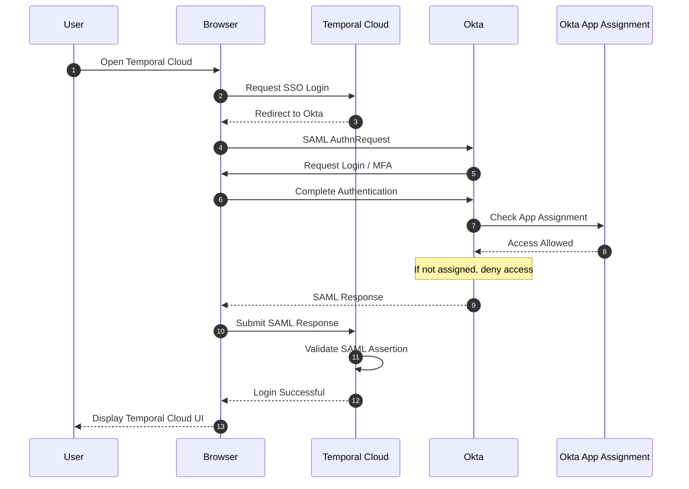
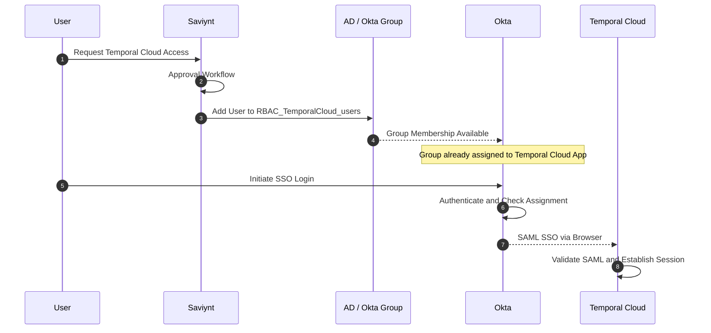

# Identity Authentication, Application Access & Authorization

## 1. 核心概念

企业身份和权限管理可以划分为三个层次：

| 层次 | 概念 | 解决的问题 | 典型实现 |
|---|---|---|---|
| 1 | Authentication | Who are you? | Okta SSO |
| 2 | Application Assignment | Which applications are you assigned to? | Okta App Assignment |
| 3 | Resource Authorization | What can you do within an application? | Temporal RBAC / ACL |

**核心结论：**

- Authentication 成功，不代表用户自动获得所有应用的访问资格。
- Okta App Assignment 决定用户是否被分配到某个 Application。
- Temporal RBAC 决定用户在 Temporal 内部拥有哪些权限。
- App Assignment 不是 SSO 协议本身强制要求的，而是 Okta 提供的一种应用访问管理机制。
- Access Control 和 Authorization 都是广义术语，不应简单等同于某一个具体层次。

## 2. Group、Role、Permission、RBAC、ACL

| 概念 | 含义 | 示例 |
|---|---|---|
| Group | 用户集合，用于批量管理用户 | `RBAC_TemporalCloud_users` |
| Role | 一组权限的集合 | Reader、Writer、Admin |
| Permission | 对资源执行某项操作的权限 | Read Workflow、Start Workflow |
| RBAC | Role-Based Access Control，基于角色的访问控制模型 | User → Role → Permissions |
| ACL | Access Control List，访问控制列表 | 资源及其允许访问的主体和操作 |
| Entitlement | 可以授予用户的访问权益，概念更广 | Group Membership、Role Assignment |

### 2.1 Group 与 Role 的关系

Group 和 Role 不一样：

- **Group** 回答：哪些用户属于同一个集合？
- **Role** 回答：该角色包含哪些权限？
- **Permission** 回答：允许执行什么操作？

一种常见的企业权限管理模型：

```text
User
  │
  ▼
Group (Engineering)
  │
  ▼
Role (Reader)
  │
  ▼
Permissions
  ├── List Workflows
  ├── Describe Workflow
  └── Read Workflow History
```

需要注意：

1. 用户可以直接获得 Role，不一定需要 Group。
2. Group 可以被分配给 Application，不一定需要绑定 Role。
3. Role 通常是一组 Permission，但不同产品对角色的具体定义可能不同。
4. RBAC 是一种权限控制模型，而 ACL 是另一种常见的权限表达机制。
5. 有些系统的内部 ACL 可以直接维护 User → Resource → Permission，而不采用 Role。

### 2.2 `RBAC_TemporalCloud_users` 是什么？

假设它是在 AD/Okta 中维护的用户组。

虽然名字包含 `RBAC`，但其实际类型是 **Group，而不是 Role**。

```text
Group: RBAC_TemporalCloud_users
    ├── User A
    ├── User B
    └── User C
```

它的作用是将一组用户组织起来，以便进行批量的 Application Assignment。

名称中的 `RBAC` 不代表这个 Group 自身拥有 Temporal Namespace 的 Reader、Writer 或 Admin 权限。

## 3. Okta App Assignment

### 3.1 App Assignment 是什么？

App Assignment 是 Okta 中用户或 Group 与 Application 之间的分配关系。

Okta 支持：

| 方式 | 解释 |
|---|---|
| Direct User Assignment | 将某个 User 直接分配给 Application |
| Group Assignment | 将 Group 分配给 Application，组内用户继承 Assignment |

例如：

```text
User A ────────────────> Temporal Cloud App
          Direct Assignment

User B ──> Group G ───> Temporal Cloud App
                  Group Assignment
```

两种方式可以同时使用。

**App Assignment 的作用是让用户具备通过 Okta 访问应用的资格，而不保证目标系统最终一定接受该用户登录。**

### 3.2 Assign multiple apps to a group

Okta 官方支持将多个 Application 分配给同一个 Group。

例如：

```text
RBAC_TemporalCloud_users (Group)
    │
    ├── Temporal Cloud App
    │
    └── Temporal Local App
```

如果 User A、User B 属于这个 Group，并且两个 Application 都被 Assign 给该 Group，那么这两个用户会继承两个 Application 的 Okta Assignment。

实际上：

- Assign Group to App
- Assign App to Group

描述的是同一种分配关系，只是从不同的管理入口操作。

### 3.3 Temporal Cloud 和 Temporal Local 复用 Group

假设目前：

```text
Group: RBAC_TemporalCloud_users
Assigned App: Temporal Cloud
```

后来增加：

```text
Assigned App: Temporal Local
```

那么：

| 用户 | Group 成员 | Cloud Assignment | Local Assignment |
|---|---|---|---|
| User A | Yes | Yes | Yes |
| User B | Yes | Yes | Yes |
| User C | No | No* | No* |

`*` 假设这些用户没有通过其他 Group 或 Direct Assignment 获得访问资格。

这意味着现有 Group 成员不需要逐个重新分配 Temporal Local Application。

但要区分：

- **Okta Assignment：** 用户已具备访问该 Application 的 Okta 分配资格。
- **实际 SSO Login：** 仍需满足 Okta 登录策略、MFA、OIDC/SAML 配置以及应用自身的身份接纳条件。
- **Temporal Authorization：** 用户登录后仍须通过 Temporal 内部的权限校验。

如果希望 Cloud 和 Local 具有相同的准入用户群，可以复用 Group。

如果希望两套环境独立管理登录资格，可以分别使用：

- `RBAC_TemporalCloud_users`
- `RBAC_TemporalLocal_users`

## 4. Temporal Cloud + Okta SSO 登录流程

Temporal Cloud 使用 Okta SAML SSO 的典型流程如下。



注：该图展示的是成功登录的简化路径。实际中，Okta 可以复用现有 SSO Session，认证与 Assignment 检查的具体顺序由配置决定；Temporal Cloud 仍可能进行额外的账号和权限检查。

### 4.1 各系统的职责

| 组件 | 职责 |
|---|---|
| Browser | 发起登录，承载 SSO 跳转 |
| Okta | 用户身份认证，执行登录策略 |
| Okta App Assignment | 确定用户是否被分配到 Temporal Cloud |
| Temporal Cloud | 验证 SAML Assertion，建立登录会话 |
| Temporal RBAC | 决定用户在 Temporal 内部能执行哪些操作 |

### 4.2 为什么一个用户能登录 Teleport，却不一定能登录 Temporal？

因为：

1. 用户通过 Okta 认证，说明 Okta 确认了其身份。
2. 用户被分配给 Teleport，不代表被分配给 Temporal Cloud。
3. 不同 Application 可以拥有独立的 App Assignment。
4. 目标应用还可能有自己的账号准入和授权条件。

**SSO 的含义是复用身份认证，而不是一次认证后自动获得所有应用的访问权限。**

## 5. Temporal Cloud 内部的 RBAC

即使 User A 能通过 Okta 登录 Temporal Cloud，也不意味着可以访问所有 Namespace。

Temporal Cloud 自身有独立的访问权限模型。

例如：

| User | Namespace | Role / Permission |
|---|---|---|
| User A | Namespace A | Reader |
| User A | Namespace B | Admin |
| User B | Namespace A | Writer |

用户对 Temporal API 发起请求时，服务端根据相应的授权策略决定是否允许。

这里的 Reader、Writer、Admin 属于 Temporal 内部 RBAC 的概念，与 Okta Group 的名称无关。

**需要特别注意：Temporal Cloud 的正式权限模型包含 Account-level Role 和 Namespace-level Permission，不能把所有权限都简单理解成 Namespace Role。**

## 6. Saviynt Application Entitlement

Saviynt 属于 IGA（Identity Governance and Administration）系统，主要用于管理应用访问权限的申请、审批、分配、审计及撤销。

### 6.1 Entitlement 是什么？

Entitlement 泛指可以授予用户的访问权益。

它可能映射到：

- Group Membership
- Application Role
- Application Access
- Resource Permission

因此：

**Entitlement 不等于 Group，也不等于 Role，它是一个更加广义的概念。**

### 6.2 与 Okta 的关系

假设公司通过 Saviynt 管理 Temporal Cloud 的访问申请：



这是一个示例方案，并非 Saviynt 与 Okta 的唯一集成方式。实际中 Saviynt 可能管理 AD Group、Okta Group 或目标系统中的其他 Entitlement，具体取决于连接器和 Provisioning 配置。

### 6.3 Saviynt、Okta、Temporal 的职责区别

| 系统 | 主要职责 | 示例 |
|---|---|---|
| Saviynt | Identity Governance | 用户申请、审批和撤销访问资格 |
| AD / Okta Group | Identity Group Management | `RBAC_TemporalCloud_users` 成员管理 |
| Okta | Authentication & App Assignment | SSO、MFA、应用分配检查 |
| Temporal Cloud | Application Authorization | Account Role、Namespace Permission |

## 7. 对 Self-hosted Temporal 的设计启示

你们希望在自建 Temporal 中使用 Okta OIDC，并通过 Temporal Frontend 实现自己的权限校验。

可以将设计分成三个独立部分：

| 部分 | 实现方案 | 负责内容 |
|---|---|---|
| Identity Authentication | Okta OIDC | 身份认证，签发 Token |
| Application Assignment | Okta | 控制谁具有 Temporal Local 应用访问资格 |
| Temporal Authorization | Frontend ClaimMapper / Authorizer / ACL | 控制 Namespace 和 API 权限 |

有一个非常重要的边界：

**即使用户被 Assign 给 Temporal Local App，也不代表 Temporal Frontend 会自动验证这个 Assignment。**

在典型的 OIDC 流程中，Okta 可以在 Token 签发前实施应用准入控制；但 Frontend 仍然需要根据自己的信任配置验证 Token，包括 issuer、audience、签名、有效期等。

如果 Frontend 只是验证 JWT 的合法性，并没有额外的应用准入检查，那么不能简单地把“Token 验证成功”视为“已完成 Okta App Assignment 检查”。

尤其当 UI、CLI 和 Workload 使用不同 OIDC Client、Token 或身份提供者时，需要明确各自适用的准入与授权路径。

## 8. 最终总结

| 问题 | 对应概念 | 负责方 |
|---|---|---|
| Who are you? | Authentication | Okta |
| Which applications are you assigned to? | App Assignment | Okta |
| Who belongs to the group? | Group Membership | AD / Okta |
| What set of permissions do you have? | Role | Temporal RBAC |
| What specific operations are allowed? | Permission | Temporal |
| How are permissions enforced? | Authorization / Access Control | Temporal Authorizer |
| Who requests and approves access? | Entitlement Governance | Saviynt |

**最值得记住的五个结论：**

1. **SSO ≠ Application Access。** 身份认证成功，不等于有资格访问任意应用。
2. **Group ≠ Role。** Group 是用户集合，Role 是权限集合；名称中包含 `RBAC` 也不改变对象类型。
3. **App Assignment ≠ Temporal RBAC。** 前者是 Okta 应用分配关系，后者是 Temporal 内部的权限管理。
4. **Entitlement 是广义访问权益。** Saviynt 可以把 Group Membership、Role Assignment 等都作为可管理的 Entitlement。
5. **Access Control 和 Authorization 是广义术语。** 在文档中建议明确使用 Okta App Assignment 和 Temporal RBAC，减少歧义。

## 9. 参考文档

- [Okta — Assign multiple apps to a group](https://help.okta.com/oie/en-us/content/topics/users-groups-profiles/usgp-assign-multiple-app-group.htm)
- [Okta — Assign a single app to groups](https://help.okta.com/oie/en-us/content/topics/users-groups-profiles/usgp-assign-app-group.htm)
- [Okta — Assign app integrations](https://help.okta.com/oie/en-us/content/topics/provisioning/lcm/lcm-user-app-assign.htm)
- [Temporal Cloud — Account Access](https://docs.temporal.io/cloud/manage-access)
- [Temporal — Security](https://docs.temporal.io/self-hosted-guide/security)
- [Saviynt — Okta Integration](https://saviynt.com/integrations/okta)
